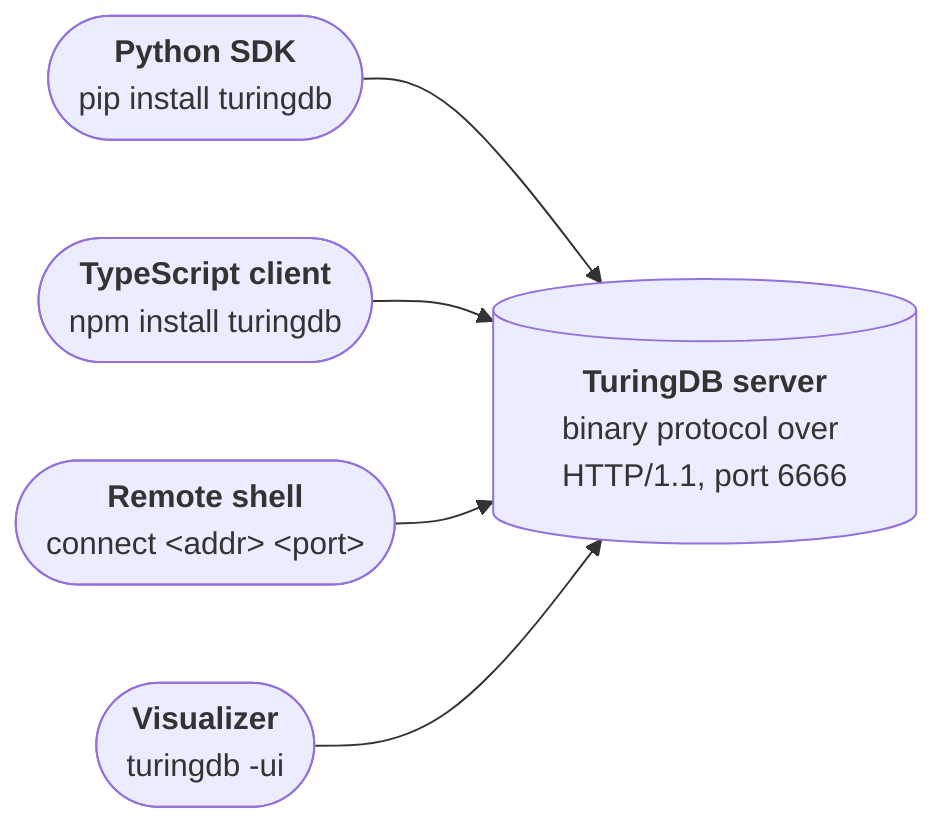
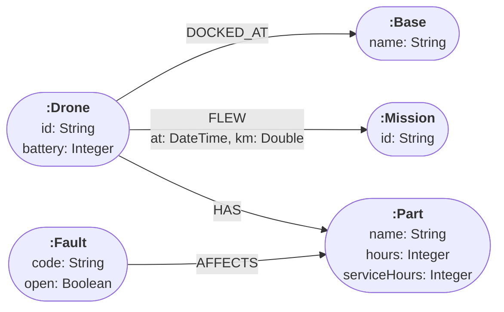

## Highlights

<CardGroup cols={2}>
  <Card title="Query parameters" icon="/images/icons/pixel-dollar.png" href="#query-parameters">
    Pass values next to the query, as in `WHERE n.age > $min` or `UNWIND $rows`: no quoting, no escaping, and faster bulk writes.
  </Card>
  <Card title="Binary protocol over HTTP/1.1" icon="/images/icons/pixel-bolt.png" href="#binary-protocol-by-default">
    The default and only protocol: results stream as typed binary columns, through standard HTTP proxies.
  </Card>
  <Card title="TypeScript client on npm" icon="/images/icons/pixel-braces.png" href="#a-typescript-client-on-npm-built-on-webassembly">
    `npm install turingdb` queries TuringDB from Node.js and the browser, decoding results in WebAssembly.
  </Card>
  <Card title="allReduce" icon="/images/icons/pixel-forall.png" href="#allreduce">
    Fold a list and test a predicate after every step: a running total or an ordering along a path.
  </Card>
  <Card title="COLLECT and other subqueries" icon="/images/icons/pixel-nested.png" href="#collect-and-other-subqueries">
    `UNION`, `NEXT` and `WHEN` inside `COLLECT`, `EXISTS`, `COUNT` and `CALL`, and `COLLECT` of maps and paths.
  </Card>
  <Card title="Points and haversine distance" icon="/images/icons/pixel-pin.png" href="#points-and-haversine-distance">
    A point property type, cartesian or WGS-84, with great-circle distances in metres and bounding boxes.
  </Card>
</CardGroup>

TuringDB 3.1 adds:

- **Query parameters.** You can send values with a query. You do not have to write them into the query text. [See more](#query-parameters)
- **The binary protocol for all clients.** This protocol runs over HTTP/1.1. [See more](#binary-protocol-by-default)
- **A TypeScript client on npm.** This client uses WebAssembly to read the results. [See more](#a-typescript-client-on-npm-built-on-webassembly)
- **The `allReduce` function** in Cypher. [See more](#allreduce)
- **Subqueries that can contain any query.** [See more](#collect-and-other-subqueries)
- **A point type.** You can use it to calculate distances on the Earth. [See more](#points-and-haversine-distance)
- **Faster matches on key properties.** When each row finds nodes by a key property, as in a `LOAD CSV` that adds edges, the query now uses a hash join. On a graph of 200,000 nodes, 1,000 edges take 7 ms instead of 5.7 s. [See more](#faster-key-property-matches)

Most of your queries work without changes. If you use the Python SDK, you must change how you connect to the server. Refer to [Upgrading from 3.0](#upgrading-from-3-0).

<CodeGroup>

```bash pip
pip install -U turingdb
```

```bash uv
uv add 'turingdb>=3.1'
```

```bash npm
npm install turingdb
```

</CodeGroup>

Released **November 9, 2026** · [Release on GitHub](https://github.com/turing-db/turingdb/releases/tag/v3.1) · [All changes since 3.0.2](https://github.com/turing-db/turingdb/compare/v3.0.2...v3.1)

## Query parameters

A `$name` parameter now stands for a value anywhere an expression goes, as well as for a label or an edge type. Values travel next to the query text, so they need no quoting or escaping:

<CodeGroup>

```python Python
client.query(
    "MATCH (n:Person) WHERE n.age >= $minAge RETURN n.name",
    {"minAge": 30},
)

# inside a change
rows = [
    {"name": "Brest", "pop": 139000},
    {"name": "Rennes", "pop": 220000},
]
client.query(
    "UNWIND $rows AS row "
    "CREATE (:City {name: row.name, pop: row.pop})",
    {"rows": rows},
)
```

```js JavaScript
await client.query(
    "MATCH (n:Person) WHERE n.age >= $minAge RETURN n.name",
    { parameters: { minAge: 30 } },
);
```

```text Shell
:param minAge => 30
MATCH (n:Person) WHERE n.age >= $minAge RETURN n.name
```

</CodeGroup>

- Parameters work in `WHERE`, `UNWIND`, property maps, `CREATE`, `MERGE`, `SET n += $props` and procedure arguments, and still stand for labels and edge types: `MATCH (n:$label)`.
- A parameter holds a string, a number, a boolean, `null`, a list or a map. From Python it can also hold a time-zone-aware `datetime` (a DateTime) or a `timedelta` (a Duration), and the shell's `:param` takes any Cypher expression, such as `datetime('2024-01-01T00:00:00Z')`.
- Parameters travel faster than text: creating 10,000 edges from a list of node-ID pairs takes about 6 ms with the list as a parameter, against about 25 ms with the same list written into the query.
- `SKIP`, `LIMIT` and the vector of a `VECTOR SEARCH` still take literals.

See [Query parameters](/query/cypher_subset#query-parameters) for the details, and [IDs in parameters](/query/matching#look-up-nodes-by-native-node-id) for the fastest lookups by node ID.

### Example: flight connections

A travel application loads the flight schedule from an operations feed, then searches for one-stop connections between two airports. The whole schedule goes in as one parameter. The search takes the departure time, the minimum and maximum time to change planes, and the size of the party as parameters:

<CodeGroup>

```python Python
from datetime import datetime, timedelta, timezone

def at(hhmm):
    h, m = map(int, hhmm.split(":"))
    return datetime(2026, 11, 12, h, m, tzinfo=timezone.utc)

# Load a batch of scheduled flights from an operations feed
schedule = [
    # flight, from, to, departs, arrives (UTC), seats left
    ("TA100", "CDG", "AMS", "07:15", "08:35", 12),
    ("TA101", "AMS", "SFO", "09:40", "20:50", 4),
    ("TA200", "CDG", "LHR", "07:00", "08:15", 20),
    ("TA201", "LHR", "SFO", "08:45", "19:55", 9),
    ("TA300", "CDG", "FRA", "06:30", "07:45", 10),
    ("TA301", "FRA", "SFO", "10:15", "21:35", 7),
    ("TA400", "CDG", "MAD", "08:00", "10:05", 3),
    ("TA401", "MAD", "SFO", "12:10", "23:40", 1),
]
flights = [
    {"number": n, "src": s, "dst": d,
     "dep": at(dep), "arr": at(arr), "seats": seats}
    for n, s, d, dep, arr, seats in schedule
]
client.new_change()
client.query(
    """
    UNWIND $flights AS f
    MERGE (a:Airport {code: f.src})
    MERGE (b:Airport {code: f.dst})
    CREATE (a)-[:FLIGHT {number: f.number, seats: f.seats,
                         dep: f.dep, arr: f.arr}]->(b)
    """,
    {"flights": flights},
)
client.query("CHANGE SUBMIT")
client.checkout()

# One-stop connections with time to change planes,
# and enough seats on both legs for the whole party
client.query(
    """
    MATCH (o:Airport {code: $origin})-[f1:FLIGHT]->(hub)
          -[f2:FLIGHT]->(d:Airport {code: $destination})
    WHERE f1.dep >= $after
      AND f2.dep >= f1.arr + $minConnection
      AND f2.dep <= f1.arr + $maxConnection
      AND f1.seats >= $party AND f2.seats >= $party
    RETURN f1.number AS first, hub.code AS via,
           f2.number AS second, f2.arr AS arrives
    ORDER BY arrives
    """,
    {
        "origin": "CDG",
        "destination": "SFO",
        "after": at("06:00"),
        "minConnection": timedelta(minutes=45),
        "maxConnection": timedelta(hours=4),
        "party": 2,
    },
)
```

```js JavaScript
// The same search. JavaScript sends the time as an ISO 8601
// string and the connection times in minutes.
const [[first, via, second]] = await client.queryData(
    "MATCH (o:Airport {code: $origin})-[f1:FLIGHT]->(hub)" +
    "-[f2:FLIGHT]->(d:Airport {code: $destination}) " +
    "WHERE f1.dep >= datetime($after) " +
    "AND f2.dep >= f1.arr + duration({minutes: $minConn}) " +
    "AND f2.dep <= f1.arr + duration({minutes: $maxConn}) " +
    "AND f1.seats >= $party AND f2.seats >= $party " +
    "RETURN f1.number, hub.code, f2.number " +
    "ORDER BY f2.arr",
    {
        parameters: {
            origin: "CDG",
            destination: "SFO",
            after: "2026-11-12T06:00:00Z",
            minConn: 45,
            maxConn: 240,
            party: 2,
        },
    },
);
```

</CodeGroup>

The search returns two connections, via Amsterdam and via Frankfurt, in order of arrival. The connection in London is too short (30 minutes, less than the minimum of 45), and the flight from Madrid has only one seat left for a party of two. In Python, a `datetime` and a `timedelta` become `DateTime` and `Duration` values, so the query can add a connection time to an arrival time.

### Example: GraphSAGE sampling for GNN training

A GNN training loop asks the server for the neighbourhood of each mini-batch with `gnn.graphSAGE`. The seed nodes of the batch are a parameter, so the query text is the same for every batch and only the values change. Before 3.1, each batch was a new query, with its node IDs written into the text.

```python
import numpy as np

# Native node IDs of the training papers, read once
train = client.query(
    "MATCH (p:Paper) WHERE p.split = 'train' "
    "RETURN id(p) AS id"
)["id"].to_numpy()

hops = ", ".join(
    f"src_nodes{h}, tgt_nodes{h}" for h in range(3)
)
sample = (
    "CALL gnn.graphSAGE($seeds, $fanouts, $rngSeed) "
    f"YIELD {hops} RETURN {hops}"
)

rng = np.random.default_rng(0)
batches = [
    b.tolist()  # plain ints: numpy values are refused
    for b in np.array_split(rng.permutation(train), 100)
]

for seeds in batches:
    # One request per mini-batch, with the same query text
    df = client.query(sample, {
        "seeds": seeds,
        "fanouts": [15, 10, 5],  # from the seeds outwards
        "rngSeed": 7,            # optional, repeatable
    })
    # Hop h: sampled in-edges src_nodes{h} -> tgt_nodes{h}.
    # The hops have different lengths, padded with nulls.
    hop0 = df[["src_nodes0", "tgt_nodes0"]].dropna()
```

On a graph of 200,000 nodes and 400,000 edges, a batch of 1,000 seeds with fanouts of 15, 10 and 5 takes about 3 ms on the server. The same `rngSeed` gives the same sample for the same batch.

`gnn.graphSAGE` now also reads its arguments from each row, so one request can sample several mini-batches. The `batch` column tells which mini-batch each row comes from:

```python
df = client.query(
    "UNWIND range(0, size($batches) - 1) AS i "
    "CALL gnn.graphSAGE($batches[i], $fanouts, $rngSeed) "
    f"YIELD {hops} RETURN i AS batch, {hops}",
    {
        "batches": batches[:4],
        "fanouts": [15, 10, 5],
        "rngSeed": 7,
    },
)
```

A seed that is not a node is refused with `Invalid node ID: <id>`. See [Procedures](/query/procedures#procedures) for the arguments and the columns of `gnn.graphSAGE`.

## Binary protocol by default

TuringDB's binary protocol is now the default, and the only protocol the server speaks, on port 6666. It runs over HTTP/1.1: a query is one request to `/query`, and its result streams back as binary packets, one per HTTP chunk, on a connection that stays open for the next query:

```text
POST /query?graph=people&commit=head&change=head HTTP/1.1
Content-Type: application/turing-proto
Authorization: Bearer <token>                (with -auth-on)

    the query text, then its parameters, in binary

HTTP/1.1 200 OK
Content-Type: application/turing-proto
Transfer-Encoding: chunked
Connection: Keep-Alive

    one binary packet per chunk:
    the column header, the column chunks, the end
```

**Benchmark.** The same queries on the same graph, from the Python SDK, with the JSON API of 3.0.2 and the binary protocol of 3.1:

| Query | 3.0.2, JSON | 3.1, binary | Faster |
| ----- | ----------- | ----------- | ------ |
| One node by ID | 0.64 ms | 0.12 ms | 5.3× |
| 1,000 nodes by ID, one query after the other | 551 ms | 126 ms | 4.4× |
| 200,000 rows: an integer and a string | 34 ms | 31 ms | 1.1× |
| 400,000 rows: two node IDs | 63 ms | 46 ms | 1.4× |
| 1,000,000 rows: an integer and a double | 168 ms | 104 ms | 1.6× |

- **Typed columns end to end.** A result streams as typed columns, in chunks of up to 65,536 rows, which each client turns straight into its own types: a pandas DataFrame in Python, typed arrays and `Column` objects in JavaScript.
- **HTTP infrastructure works as is.** Standard reverse proxies such as nginx forward the protocol with a plain `proxy_pass`, browsers reach it with `fetch`, and authentication uses the standard `Authorization: Bearer` header, which a proxy can also add.
- **Every client speaks it.** The Python SDK uses it by default, `TuringDB(host="localhost", port=6666)`, and so do the new TypeScript client, the shell's `connect <addr> <port>` and the visualizer.



Use one of the clients rather than writing requests by hand. See [Connecting clients](/commands#connecting-clients).

## A TypeScript client on npm, built on WebAssembly

The `turingdb` npm package queries TuringDB from TypeScript and JavaScript. It decodes the streamed columns with a WebAssembly build of the engine's own decoder, so the browser, Node.js and the server run the same decoding code. It runs in Node.js 18 or later and in the browser, has no dependencies, and ships with TypeScript declarations.


```ts
import { TuringClient, TuringQueryError } from "turingdb";

const client = new TuringClient({
    url: "http://localhost:6686/query",
    graph: "people",
});

try {
    const [[names, ages]] = await client.queryData(
        "MATCH (p:Person) WHERE p.age >= $age " +
        "RETURN p.name, p.age ORDER BY p.name",
        { parameters: { age: 30 } },
    );
    console.log(names, ages);   // [ 'Marie' ] [ 33 ]
} catch (e) {
    if (e instanceof TuringQueryError) {
        console.error(e.status, e.message);
    }
}
```

- **Typed columns.** `query()` returns `Column` objects: 64-bit integers and node IDs as `bigint`, numeric columns as typed arrays with no per-row work, embeddings as `Float32Array` and points as `Point` objects. `queryData()` returns plain arrays.
- **The whole workflow.** Parameters, changes (`CHANGE NEW`, `setChange()`, `CHANGE SUBMIT`), past commits through the `commit` option, cancellation with an `AbortSignal`, and `-auth-on` tokens.
- **Node.js and the browser.** Node.js refuses port 6666, so start the server on another one, such as `turingdb -p 6686`. A web page reaches the server through a proxy on its own origin, and Vite, webpack 5 and other bundlers ship the `.wasm` decoder with the build.

Read [Get started](/jssdk/get_started) for a walkthrough, including a Vite and nginx setup for web applications, and the [Reference](/jssdk/reference) for every option and type.

## `allReduce`

`allReduce(acc = init, x IN list | step, predicate)` folds a list like `reduce`, and is `true` when the predicate holds for the accumulator after **every** step. It stops at the first step that fails. Over the nodes or edges of a path, it tests a condition at each hop:

```cypher
MATCH p = (a:Person {name: 'Alice'})-[:KNOWS]->+(b)
WHERE allReduce(
  total = 0, n IN nodes(p) | total + n.age,
  total <= 100
)
RETURN b.name, length(p) AS hops
```

The ages along `Alice → Bob → Carol` add up to 93, so the paths to Bob and Carol are kept, while adding Dave makes 134. A map accumulator carries more than one value from step to step, for example to keep the paths along which the `since` years of the edges increase:

```cypher
MATCH p = (a:Person {name: 'Alice'})-[:KNOWS]->+(b)
WHERE allReduce(
  acc = {}, r IN relationships(p) |
    {prev: acc.cur, cur: r.since},
  acc.prev IS NULL OR acc.prev < acc.cur
)
RETURN b.name, length(p) AS hops
```

The initial value is never tested, an empty list gives `true`, and a `null` list gives `null`. Paths are values too: `collect(p)` gathers them, lists and maps hold them, and a pattern comprehension can name its path, as in `[p = (a)-[:KNOWS]->+() | length(p)]`. See [Filtering paths with `allReduce`](/query/paths#filtering-paths-with-allreduce).

## COLLECT and other subqueries

Every subquery now holds any query. `UNION`, `NEXT` chains and `WHEN` conditionals work inside `COLLECT`, `EXISTS`, `COUNT` and `CALL` bodies, and a `WHEN` branch can hold a `UNION`:

```cypher
MATCH (p:Person {name: 'Alice'})
RETURN COLLECT {
  MATCH (p)-[:KNOWS]->(f)
  RETURN f AS friend
  NEXT
  MATCH (friend)-[:KNOWS]->(fof)
  RETURN fof {.name, .age}
} AS twoHopsAway

MATCH (p:Person)
WHERE EXISTS {
  WHEN p.age > 30 THEN MATCH (p)-[:KNOWS]->(f) RETURN f
}
RETURN p.name

MATCH (p:Person)
RETURN p.name, COUNT {
  WHEN p.city = 'London'
    THEN MATCH (p)-[:KNOWS]->(f) RETURN f AS x
  ELSE MATCH (p)-[:LIKES]->(x) RETURN x
} AS links
```

- `COLLECT { }` and `collect()` gather maps and paths, so a subquery can collect several values per match: `COLLECT { MATCH (p)-[:KNOWS]->(f) RETURN f {.name, .age} }`.
- The branches of a `UNION` or a `WHEN` can return different types in one column.
- `exists()` takes a pattern as a function, as in Neo4j 5: `RETURN p.name, exists((p)-[:LIKES]->()) AS likes`.

See [Subqueries](/query/subqueries) and [NEXT and WHEN](/query/composition#inside-exists-count-and-collect).

### Example: drone fleet status

A fleet dashboard shows each drone docked at a base: its battery, whether it can fly, its last two flights and its maintenance tasks. One query builds a document for each drone. The tasks come from two sources, open faults and parts due for service, joined by a `UNION` inside `COLLECT`. The graph has this structure:



The query:

```cypher
MATCH (d:Drone)-[:DOCKED_AT]->(:Base {name: $base})
RETURN d {
  .id, .battery,
  ready: d.battery >= $minBattery AND NOT EXISTS {
    MATCH (d)-[:HAS]->(:Part)
          <-[:AFFECTS]-(:Fault {open: true})
  },
  lastFlights: COLLECT {
    MATCH (d)-[f:FLEW]->(m:Mission)
    RETURN m {.id, km: f.km} ORDER BY f.at DESC LIMIT 2
  },
  tasks: COLLECT {
    MATCH (d)-[:HAS]->(p:Part)
          <-[:AFFECTS]-(x:Fault {open: true})
    RETURN 'repair ' + p.name + ' (' + x.code + ')' AS task
    UNION
    MATCH (d)-[:HAS]->(p:Part)
    WHERE p.hours >= p.serviceHours
    RETURN 'service ' + p.name AS task
  }
} AS drone
ORDER BY drone.id
```

With `$base` set to `'Lyon-Nord'` and `$minBattery` to `30`, it returns one document for each drone:

```json
{"id": "D-101", "battery": 82, "ready": true,
  "lastFlights": [{"id": "M-884", "km": 8.1},
                  {"id": "M-881", "km": 12.4}],
  "tasks": ["service camera"]}
{"id": "D-102", "battery": 24, "ready": false,
  "lastFlights": [{"id": "M-882", "km": 21.7}],
  "tasks": []}
{"id": "D-103", "battery": 67, "ready": false,
  "lastFlights": [{"id": "M-861", "km": 5.2}],
  "tasks": ["repair rotor 2 (E-17)", "service gimbal"]}
```

D-102 cannot fly because its battery is below 30%, and D-103 because of the open fault E-17 on a rotor. A drone with no flight or no task gets an empty list, and its row is kept.

## Points and haversine distance

Points are a new property type, 2D or 3D, on a plane (cartesian) or on the Earth (WGS-84). `point.distance` gives the great-circle distance in metres between two WGS-84 points, by the haversine formula on a sphere of the mean Earth radius:

```cypher
CREATE
  (:City {name: 'Paris',
    at: point({latitude: 48.8566, longitude: 2.3522})}),
  (:City {name: 'London',
    at: point({latitude: 51.5074, longitude: -0.1278})})

MATCH (a:City {name: 'London'}), (b:City {name: 'Paris'})
RETURN round(point.distance(a.at, b.at) / 1000) AS km

MATCH (c:City)
WHERE point.withinBBox(
  c.at,
  point({latitude: 48, longitude: 1}),
  point({latitude: 50, longitude: 3})
)
RETURN c.name
```

The second query returns `344`, and the third returns Paris.

- **Building and reading.** `point({x, y})`, `point({x, y, z})`, `point({longitude, latitude})` and `point({longitude, latitude, height})`, read back through `p.x`, `p.latitude`, `p.crs`, `p.srid` and the other components.
- **Distances.** Straight-line between cartesian points. Great-circle on the Earth's mean radius, 6,371,008.8 m, between WGS-84 points, and combined with the height difference in 3D. Neo4j uses a radius of 6,378,140 m, so its distances are about 0.11% longer.
- **Bounding boxes.** `point.withinBBox(p, lowerLeft, upperRight)`, with boxes that can cross the 180th meridian.
- **Sorting and aggregating.** Points compare, sort, group and deduplicate, and `min`, `max` and `avg`, the centroid, work over them.
- **Importing.** `LOAD JSONL ... WITH POINTS [...]` reads JSON objects as points, and `LOAD PARQUET` reads the WKB point columns of GeoParquet files.
- **Clients.** Points come back as `turingdb.Point` in Python and as `Point` objects in TypeScript.

See [Points](/query/functions#points).

## Also in 3.1

### Map projection and map access

```cypher
MATCH (n:Person)-[:WORKS_AT]->(c:Company)
RETURN c.name,
  collect(n {.name, .age, senior: n.age > 30}) AS staff

WITH {a: {b: 2}, label: 'x'} AS m
RETURN m.a.b, m['label']
```

`n {.*}` takes every property, and a map can hold nodes and datetimes and read through them: `m.p.name`, `m.d.year`. See [Map projection](/query/functions#map-projection).

### Setting properties from a map

```cypher
MATCH (n:Person {name: 'Alice'})
SET n += {city: 'Berlin', score: 1.5}

MATCH (c:Company {name: 'Acme'})
SET c = {name: 'Acme Corp', size: 10}
```

`SET n += map` adds and updates properties, `SET n = map` replaces them all, and a key set to `null` removes its property. See [Setting properties from a map](/query/writing#setting-properties-from-a-map).

### New functions and operators

| Added | Example |
| ----- | ------- |
| `IS` label tests | `WHERE n IS Person\|Company` |
| `elementId(x)` | The same integer as `id(x)` |
| `isEmpty(x)` | `isEmpty([])`, `isEmpty('')` and `isEmpty({})` are `true` |
| `coll.indexOf(list, value)` | `coll.indexOf(['a', 'b'], 'b')` is `1` |
| `split` on several delimiters | `split('a,b;c', [',', ';'])` is `['a', 'b', 'c']` |
| `datetime` of a map | `datetime({year: 2024, month: 3, day: 15, hour: 10})` |
| `sum` and `avg` of durations | `sum(d)` over `Duration` values |

### A new parser

A hand-written recursive descent parser replaces the generated one. It is much faster, and reads queries the way Neo4j does:

- **Much faster.** In our measurements, it parses queries about twice as fast as the parser of 3.0: a 12-line query in 23 µs instead of 54 µs, and a 130 KB query in 6.6 ms instead of 13 ms.
- `/* */` block comments, and keywords as names: `RETURN n.name AS count, n.age AS order`.
- `STARTS WITH`, `ENDS WITH` and `CONTAINS` bind more loosely than `+`, so `'a' + 'bc' ENDS WITH 'bc'` is `true`.
- Dotted chains read through nested values: `m.a.b`, `m['key']`, `ms[1].a`.

### Faster key-property matches

A query often finds nodes by a key property for each row, for example in the edge pass of a `LOAD CSV`:

```cypher
LOAD CSV 'knows.csv' WITH HEADERS AS row
MATCH (a:Person {pid: toInteger(row.src)}),
  (b:Person {pid: toInteger(row.dst)})
CREATE (a)-[:KNOWS]->(b)
```

In 3.0, each row scanned all the nodes with the label. In 3.1, the query scans the label one time and joins the rows to it with a hash join. Measured on the same graph of 200,000 nodes and 400,000 edges:

| 1,000 rows | 3.0.2 | 3.1 |
| ---------- | ----- | --- |
| `LOAD CSV` that adds edges by key, as above | 5.7 s | 7 ms |
| `UNWIND` of key pairs, with a match by key for each node of the pair | 7.6 s | 9 ms |
| `UNWIND` of keys, with one match by key | 245 ms | 4 ms |

Key pairs passed as a parameter (`UNWIND $pairs AS p`) also use a hash join. One key for each row from a parameter (`UNWIND $keys AS x MATCH (n:Person {pid: x})`) does not use a hash join yet. For this case, get the node IDs of the keys, and use `UNWIND $ids AS x MATCH (n) WHERE n = x`.

### More of what you write just works

- Writes store values read from maps and lists directly: `CREATE (:City {name: row.name, pop: row.pop})` needs no `toString()` or `toInteger()`. A new property takes the type of its values.
- Paths are values: lists and maps hold them, and `CASE` and `coalesce` return them, as in `collect(p)`, `{route: p}` and `coalesce(p, q)`.
- `ORDER BY` after `DISTINCT` or beside an aggregate sorts by a key or a property of a returned item: `RETURN DISTINCT {age: n.age} AS m ORDER BY m.age`.
- `WHERE n IN [0, 1, 2]` looks the nodes up by ID directly, like `UNWIND [0, 1, 2] AS x MATCH (n) WHERE n = x`.
- `range()` takes bounds read from maps and lists, and `sum()` of integers read from maps stays an Integer.
- A runtime type error names the type the row holds: `toUpper() reads a string, not 'Integer'`.
- `gnn.graphSAGE` reads its arguments from each row, and rejects a seed that names no node.
- The planner starts a pattern from the node expected to produce the fewest rows, with estimates built from the number of edges of each type, and sizes a hash join by its smaller side.

### Python SDK

- `TuringDB(host="localhost", port=6666)` connects over the binary protocol, as soon as it is created. `type` is `"native"`, the default, or `"embedded"`.
- A `DateTime` or a `Duration` inside a list or a map comes back as a time-zone-aware `datetime.datetime` or a `datetime.timedelta`, rather than a string.
- `list_available_graphs()` works on every backend, the embedded one included.
- `try_reach(timeout)` and `warmup(timeout)` give up after `timeout` seconds.
- The package no longer depends on `httpx` and `orjson`.

See the [Python SDK reference](/pythonsdk/reference).

## Upgrading from 3.0

<Steps>
  <Step title="Upgrade the server and the clients together">
    A 3.1 client speaks the protocol of a 3.1 server, so upgrade `turingdb` on PyPI, `turingdb` on npm and the server at the same time, then restart the server:

    ```bash
    pip install -U turingdb
    turingdb stop && turingdb -demon
    ```

    A client and a server of different versions fail with a protocol error, see [Troubleshooting](/troubles/troubles#a-client-and-a-server-of-different-versions).
  </Step>
  <Step title="Connect with a host and a port">
    Pass the host and the port separately:

    ```python
    from turingdb import TuringDB

    # or simply TuringDB()
    client = TuringDB(host="localhost", port=6666)
    ```

    A URL in `host` is refused with `host must be a host name or IP address, not a URL`. The client now connects as soon as it is created, so a server that is not running is reported right away.
  </Step>
  <Step title="Read paths as lists of IDs">
    `RETURN p` returns a path as a list of IDs, node and edge alternating: `[0, 0, 1]` is node 0, edge 0 and node 1. Code that read the `type` and `id` keys of each step should read the list instead.
  </Step>
  <Step title="Check the results that changed">
    A few results now follow Neo4j:

    | Expression | 3.0 | 3.1 |
    | ---------- | --- | --- |
    | `[1, 2] + null` | `[1, 2, null]` | `null` |
    | `{a: null} = {a: 1}` | `false` | `null` |
    | `'a' + 'bc' ENDS WITH 'bc'` | `'atrue'` | `true` |
    | `duration({hours: null})` | `null` | an error naming the unit |
    | `sum(row.v)` over integers read from maps | a Double | an Integer |
  </Step>
  <Step title="Pass values as parameters">
    Optional, but recommended: replace the values your application writes into query text, and the code that escapes them, with [parameters](/query/cypher_subset#query-parameters). They are safer and faster.
  </Step>
</Steps>

## Removed

- **The JSON API.** The server answers the binary protocol only, so scripts that sent JSON queries to it, with `curl` for example, need one of the clients.
- **In the Python SDK:** `type="json"`, a URL in `host`, the `HTTPClient` class and the `TURINGDB_TYPE` environment variable.
- **On the server:** the `USE_TURING_PROTO` environment variable, since the binary protocol is always on, and the `REQUEST_TOO_BIG` error code. A request over 1 MiB is now refused with a protocol error that names the limit.

## Known limitations

These are not available yet, and are on the roadmap:

- Parameters in `SKIP` and `LIMIT`, and as the vector of a `VECTOR SEARCH`.
- Regular expressions (`=~`) and `--` comments.
- `rand()`, `date()`, `timestamp()`, `atan2()`, `isNaN()` and `round(x, digits)`.
- `SET n:Label`, `CALL { } IN TRANSACTIONS` and `OPTIONAL CALL` on a procedure.

Tell us which ones matter to you on [Discord](https://discord.gg/dMM48ns5VY) or by email at [team@turingdb.ai](mailto:team@turingdb.ai). For the full list of changes, see the [v3.1 release on GitHub](https://github.com/turing-db/turingdb/releases/tag/v3.1).
